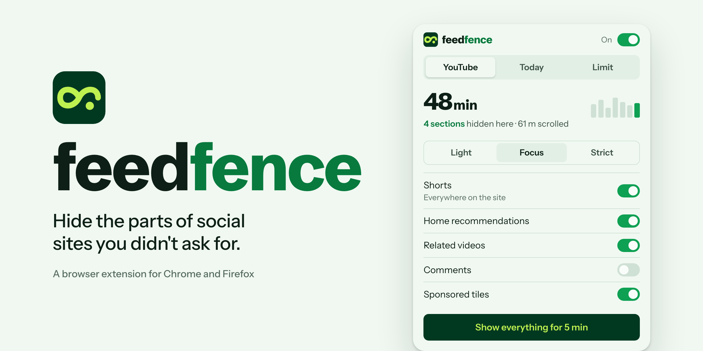

<picture>
  <source media="(prefers-color-scheme: dark)" srcset=".github/assets/cover-dark.png">
  
</picture>

# Feedfence

A browser extension that hides the parts of social sites you didn't ask for, and shows where your time goes. Made by DotbrainLLC.

Feedfence is in early development. Nothing is published to the Chrome Web Store or Firefox Add-ons yet.

## What it does

- **Hides sections:** Shorts, Reels, recommendations, trends, sidebars and sponsored posts, one switch each.
- **Tracks time:** active time per site per day, counted only while the tab is visible and you're using it.
- **Measures scrolling:** an approximate distance per day, compared to a landmark.
- **Sets soft limits:** an optional daily limit with a gentle reminder and a 5-minute escape.

It covers YouTube, X, Reddit, LinkedIn, Instagram and Facebook. Feedfence isn't affiliated with any of these sites.

## Privacy

Everything stays in your browser. Feedfence has no account, no analytics and makes no network requests. Your time and scroll data live in local extension storage, and you can export them as CSV or delete them at any time from **Your data** in the popup.

## Development

You need Node 24 (the version in `.nvmrc`) and npm. The project uses [WXT](https://wxt.dev), Svelte 5 and TypeScript.

```
npm install
npm run dev
```

`npm run dev` rebuilds as you edit. Load `.output/chrome-mv3-dev` once as an unpacked extension (steps below), and it reloads itself after each change. For Firefox, run `npm run dev:firefox` and load `.output/firefox-mv3-dev`.

| Command | What it does |
|---|---|
| `npm run build` | Builds Chrome and Firefox versions into `.output/`. |
| `npm run check` | Type-checks the TypeScript and Svelte code. |
| `npm test` | Runs the unit tests. |
| `npm run lint:firefox` | Runs the Firefox add-on linter on the Firefox build. It downloads `web-ext` on first use. |
| `npm run zip` | Packs both builds for store upload, plus the Firefox source ZIP. |

To load a build by hand in Chrome, open `chrome://extensions`, turn on Developer mode, click "Load unpacked" and pick `.output/chrome-mv3`. In Firefox, open `about:debugging#/runtime/this-firefox`, click "Load Temporary Add-on" and pick `.output/firefox-mv3/manifest.json`.

## Building from source

These steps rebuild the exact files in the store packages. They're what Firefox Add-ons reviewers run.

1. Use any OS with Node 24 and npm 11. The packages were built on macOS 27; Node 22 and Node 24 give identical output.
2. Unpack the source and run `npm ci` in its folder. It installs the versions pinned in `package-lock.json`.
3. Run `npm run zip`.

The Firefox build lands in `.output/firefox-mv3/` and its package in `.output/feedfence-0.1.0-firefox.zip`. The Chrome build lands in `.output/chrome-mv3/`. Nothing is downloaded at build time beyond the npm packages, and the code isn't obfuscated.

## Project layout

| Path | What's in it |
|---|---|
| `src/entrypoints/` | The popup, the welcome and Your data pages, the background script, one content script per site, and the time meter and limit reminder that run on every supported site. |
| `src/lib/` | Settings, usage, limit and export logic, with unit tests next to each file. |
| `docs/` | The per-site re-test checklist. |
| `src/assets/tokens.css` | Colors, type and spacing from the brand kit. |
| `public/icon/` | Extension icons at 16, 32, 48 and 128 px. |

## Docs

- [Contributing](CONTRIBUTING.md): how changes move from issue to merge.
- [Site checks](docs/site-checks.md): how to re-test each site, and when each was last verified.
- [Security policy](SECURITY.md): how to report a security issue.

## License

[MIT](LICENSE). The Feedfence name and logo aren't covered by the license; please don't use them for your own builds.

## Help

Found a bug or have an idea? [Open an issue](https://github.com/dotbrainhq/feedfence/issues/new/choose).
